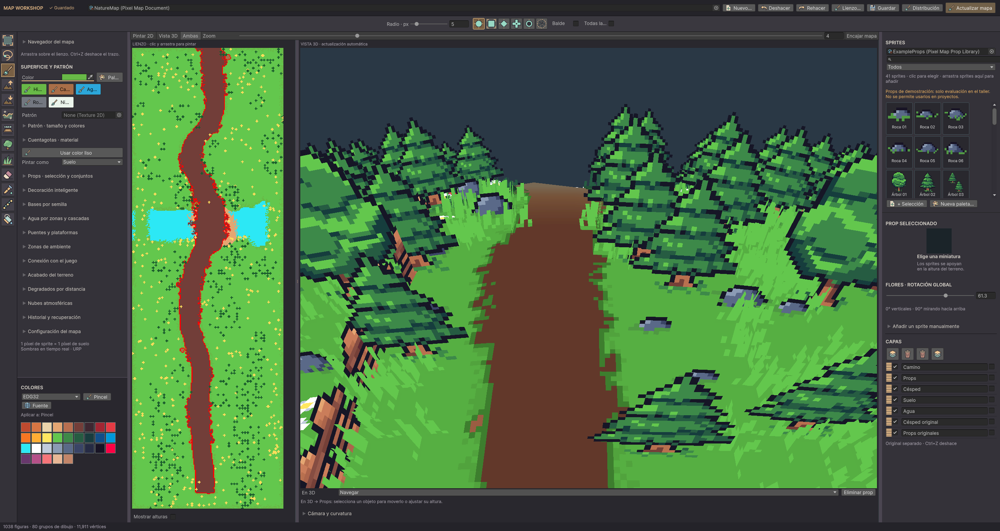
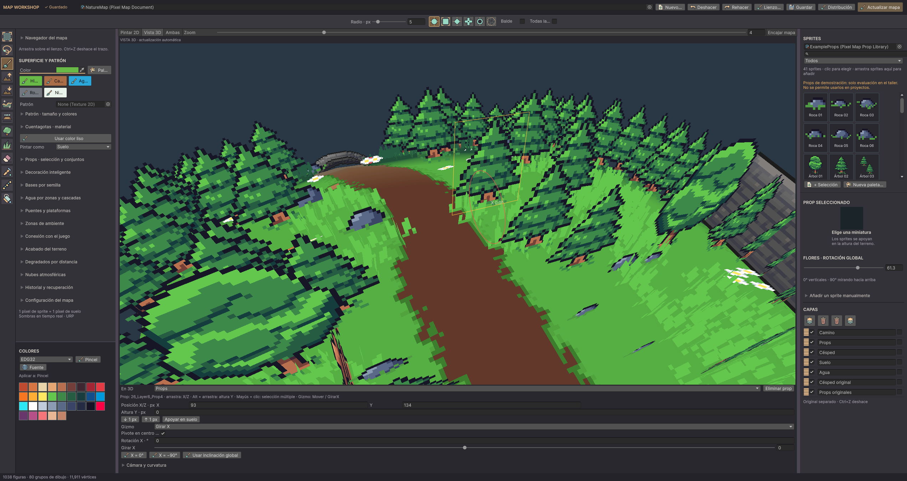
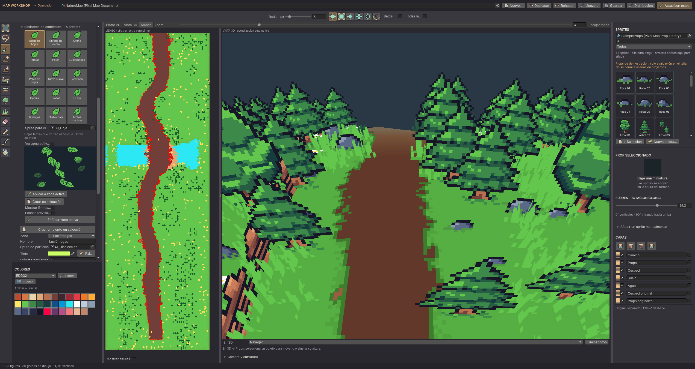

# Pixel Map Workshop

**A pixel-art world builder for Unity, by HeartDev.** Paint terrain in 2D, inspect it in a curved 3D preview, place sprite props and bake your map to a prefab.

> **License:** the tool may be used for commercial projects **with attribution**.
> Its code may not be redistributed, resold, sublicensed or transferred, except for
> the narrow permissions in [LICENSE](LICENSE), including GitHub-required forks.
> **All bundled props, sample maps and screenshots are demonstration-only. They may
> not be used in any project.** See [LICENSE-EXAMPLES.txt](LICENSE-EXAMPLES.txt).

## Features

- Six pixel brushes, flood fill, pattern tinting/blending and eyedropper material sampling.
- Paint layers with visibility, locking, drag ordering and undo/redo.
- Pixel-based terrain heights, smoothing, flattening and canvas expansion.
- 2D/3D split view, a curved-world preview and adjustable panels with saved layouts.
- Sprite props, crossed planes, ground planes and textured boxes.
- Multiple/area prop selection, select all matching sprites, X rotation, 3D transform gizmos, individual/group pivots and reusable groups.
- Area decoration with seeded mixes, spacing and water/path exclusions.
- Editable seed-based starting maps: forest, mountains, archipelago and crypt.
- Bridges/platforms, separate water zones and animated waterfall strips.
- Three-color shoreline water, animated foam and terrain distance gradients also inherited by grass clusters.
- Fifteen distinct ambient behaviors with real Unity particle previews in both viewers, up to four sprite variants per zone, natural variation and a global particle budget.
- Underwater algae animated in the shader on a single plane with ten height segments.
- Prefab baking and updates that preserve the connected prefab's references.
- Manual saving, an automatic recovery copy and an operation history.

## Requirements

- **Unity 6000.6.0f1 / Unity 6.6** is the development baseline. Older versions have not been validated.
- **Universal Render Pipeline 17.6.0**, with an available **Universal 3D renderer**.
  A 2D-only renderer setup cannot render the terrain preview.
- Unity's built-in UI Toolkit/IMGUI, vector graphics, particles and sprite modules.
- Aseprite is optional: the included examples are standalone PNG sprites.

Unity, URP, fonts and unrelated third-party packages are not bundled.

## Install

1. Download the official `PixelMapWorkshop-0.1.0.unitypackage` from [Releases](https://github.com/HeartDev0/pixel-map-workshop/releases), or download this repository and copy **`Assets/HeartDev/MapWorkshop`** into your project's `Assets/HeartDev/` directory. Keep the `.meta` files.
   The repository contains the latest changes; the tagged 0.1.0 package is the original preview.
2. Install/enable URP and make sure the pipeline asset contains a **Universal Renderer Data** entry for 3D. You may keep a different renderer as your game's default.
3. Open **Tools → HeartDev → Pixel Map Workshop**.
4. Click **Nuevo…** and create your own map document. Add your own sprites to a prop library.

The path `Assets/HeartDev/MapWorkshop` is currently required by the editor's stylesheet/icon lookup. This is an Assets-based tool, not a UPM package.

### Explore the demonstration

Select `Assets/HeartDev/MapWorkshop/Examples/Restricted/NatureMap.asset` and choose **Abrir Map Workshop**. Choose `ExampleProps.asset` in the sprite library field if needed. It contains 52 extracted example sprites, including trees, rocks, fences, a wall, an arch, a sign, flowers, grass, algae and a leaf.

**Inspect these examples only inside the workshop. Replace every restricted resource with your own assets before creating or exporting a project you will use or publish.** The UI displays a warning when the restricted example library is selected.

## Quick workflow

1. Paint ground, paths or water in 2D or in **En 3D → Pintar**.
2. Sculpt using **Elevar**, **Rebajar**, **Suavizar** or **Aplanar**. Painting a color and changing height are separate tools.
3. Select sprite thumbnails to place props; use **En 3D → Props** to select and transform them.
4. Draw a rectangle/lasso to fill an area, create a water zone, a bridge or an ambient zone.
5. In **Bases por semilla**, preview a base and create a **new** document from it; this preserves your current map.
6. Save the authoring document. Use **Actualizar mapa** to update its destination prefab, or **Conexión con el juego → Exportar copia…** for a separate export.

Detailed Spanish instructions: [Guía de uso](docs/GUIA_ES.md). License summary: [Permisos en español](docs/LICENSE_ES.md).

### Shortcuts

| Action | Shortcut |
|---|---|
| Paint / prop / grass / erase props / eyedropper | B / P / G / E / I |
| Prop line / bucket / rectangle / lasso | T / F / M / L |
| Copy / cut / paste / duplicate / select all | Ctrl/Cmd+C / X / V / D / A |
| Undo | Ctrl/Cmd+Z |
| Pan / zoom canvas | Space+drag or middle drag / Ctrl+wheel |
| Orbit / distance / travel in 3D | Right drag / wheel / middle drag |
| Add/remove a prop from the 3D selection | Shift+click |
| Height while dragging a selected prop | Alt+drag |
| Snap X rotation / cancel gizmo drag | Shift / Esc |

## Screenshots

All images below are captures of the real Unity editor/preview, not concept art. The artwork shown remains restricted demonstration material.

## Export and runtime

Authoring scripts live in an **Editor-only assembly**. Exported maps use standard Unity meshes, materials, URP shaders and native particle systems. Grass/props are combined by atlas and strip rather than creating a GameObject per blade. The preview curvature is not permanently baked into the map.

The published repository contains **no game/campaign integration**. Connect the resulting prefab in your own project. The embedded runtime-shader permission in LICENSE lets you display your own output in distributed commercial games; it does not permit redistributing the editor or a reusable shader pack.

## Status and limitations

This is a **0.1.0 preview**. Compilation and editor diagnostics were checked in the development project; a clean-project compatibility matrix and Android performance certification have not been completed. No automated test suite is claimed.

Terrain is a height surface. Crypt presets create rooms/corridors as a starting base; arbitrary caves, overhangs, navigation and physical water simulation are not implemented. Ambient areas are rectangular; a preset configures effects and still needs an appropriate sprite. The supplied recovery mechanism keeps one copy per document.

If you encounter Unity's `EditorStyles.toolbarButtonRight` / `PropertyEditor.Styles` initialization error, see [Troubleshooting](docs/TROUBLESHOOTING.md).

## Required attribution

Add a reasonably visible credit in your distributed project's credits, About screen, NOTICE or documentation:

> Maps created with Pixel Map Workshop by HeartDev — https://github.com/HeartDev0/pixel-map-workshop

Attribution does **not** grant permission to use the example artwork. See [NOTICE](NOTICE) and [third-party palette credits](THIRD_PARTY_NOTICES.md).
